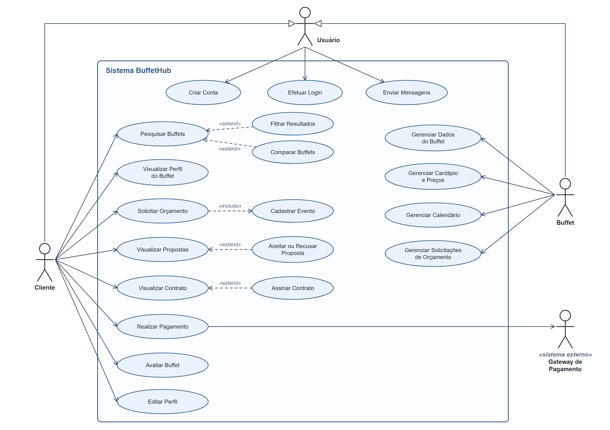
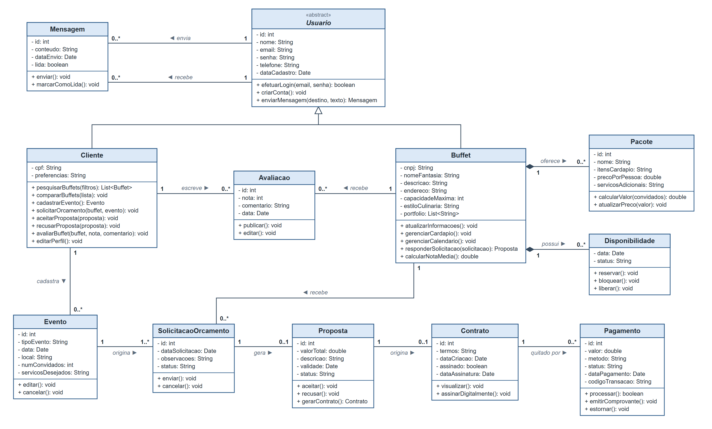
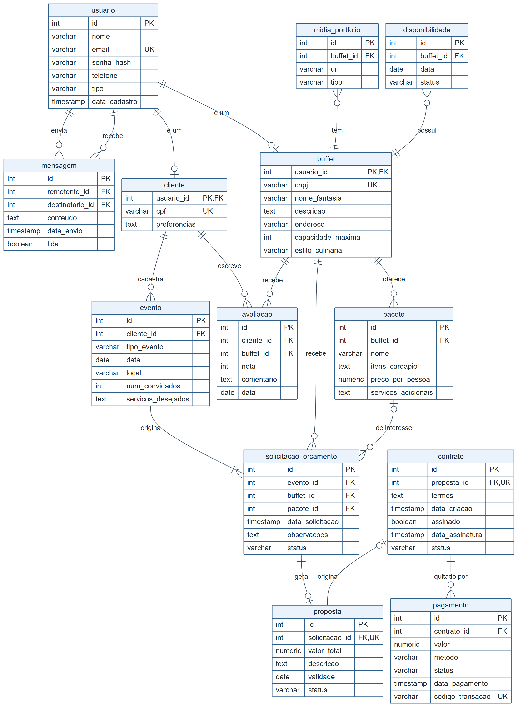
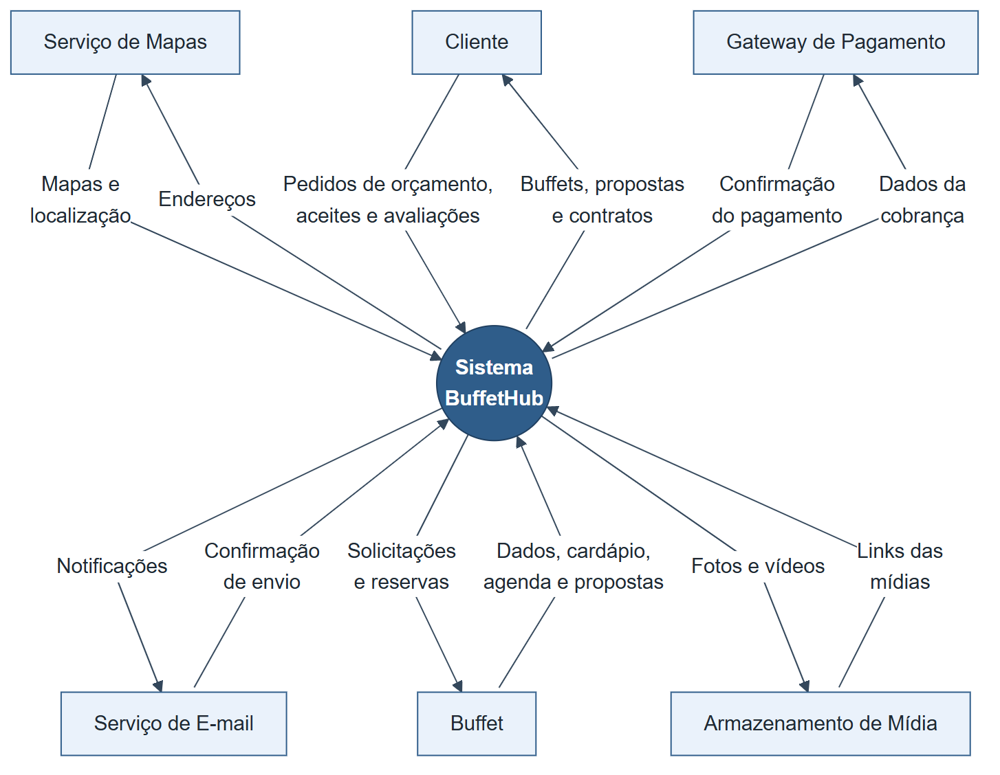

# BuffetHub

Plataforma web que conecta clientes que estão organizando um evento a buffets. O cliente pesquisa e compara
buffets, pede orçamento, recebe a proposta, assina o contrato, paga e avalia. O buffet cuida do seu perfil,
cardápio, preços, calendário e responde aos pedidos de orçamento.

Projeto da disciplina **Engenharia de Software e Arquitetura de Sistemas** – FECAP, Ciência da Computação, 4º semestre.
Professor: Luis Fernando dos Santos Pires.

**Grupo CTRL+ALT+DEL:** Yuri Oliveira Santana, Mauricio Suster, Kaio Inglez e Bruno Nóbrega.

## 🌐 Site publicado

**[LINK DA VERCEL – inserir aqui](https://vercel.com)**

## 📄 Documentação

| Documento | Arquivo |
|---|---|
| Documentação técnica completa (capítulo Produção Técnica) | [PDF](assets/documentacao/Documentacao_Tecnica_BuffetHub.pdf) · [Word](assets/documentacao/Documentacao_Tecnica_BuffetHub.docx) |
| Diagrama de caso de uso e diagrama de classe | [PDF](assets/documentacao/Entrega_UML_BuffetHub.pdf) |
| Especificação dos 20 casos de uso | [PDF](assets/documentacao/Especificacao_Casos_de_Uso_BuffetHub.pdf) |
| Base do projeto (telas, tecnologias, status e processos) | [PDF](assets/documentacao/Base_do_Projeto_BuffetHub.pdf) |
| Planilha de requisitos (RF, RNF, associações e projeto linear) | [Excel](assets/documentacao/Requisitos.xlsx) |
| Todo o material em um único arquivo | [PDF](assets/documentacao/BuffetHub_Material_Completo.pdf) |

A documentação técnica traz: sitemap, wireframes, protótipo, arquitetura funcional, técnica e MVC, requisitos,
macroprocesso, fluxograma, BPMN, diagramas de caso de uso, classe, entidade-relacionamento, máquina de estados,
operação, fluxo de dados, processos (telas), ferramenta CASE e diagrama de contexto.

### Principais diagramas

**Diagrama de caso de uso**



**Diagrama de classe**



**Diagrama de entidade-relacionamento**



**Diagrama de contexto**



Outros diagramas em [`assets/diagramas`](assets/diagramas): arquitetura funcional, arquitetura técnica,
arquitetura MVC, sitemap, BPMN e máquina de estados.

> **Observação:** a documentação descreve o back-end em Node.js/Express no Render com Prisma e Cloudinary.
> Na implementação, essas partes foram substituídas pelo **Supabase** (banco PostgreSQL, autenticação, fotos e
> tempo real) e o site fica na **Vercel**. As telas, os casos de uso, os dados e as regras de negócio são os mesmos.

## 🛠 Tecnologias

- **Next.js 16** (React + TypeScript + Tailwind) hospedado na **Vercel** – telas (View) e rotas de servidor (Controller)
- **Supabase** – banco PostgreSQL com regras de segurança (RLS), autenticação, armazenamento e tempo real (Model)
- Pagamento **simulado** (Pix, cartão e boleto) feito por uma função do banco

## ✅ O que já está pronto

- Banco completo em `supabase/migrations`: 14 tabelas do DER, regras de negócio dos casos de uso
  (orçamento, proposta, contrato, assinatura, pagamento simulado, avaliação, calendário, mensagens),
  segurança com RLS e dados de demonstração em `supabase/seed.sql`
- **T4.0 Busca de buffets** com filtros (nome, cidade, tipo de evento, nº de convidados, preço e culinária)
- **T5.0 Perfil do buffet** com fotos, cardápio e preços, avaliações e datas indisponíveis

## 🚧 Em desenvolvimento

Cadastro e login (T1.0–T3.0), solicitar orçamento (T5.1), painel do cliente (T7.x), checkout (T6.0),
painel do anfitrião (T8.x), mensagens e mapa. As regras desses casos de uso já estão prontas no banco.

## 📁 Estrutura de pastas

```text
buffethub/
├── assets/
│   ├── documentacao/   → PDFs, Word e planilha da documentação
│   └── diagramas/      → imagens dos principais diagramas
├── public/demo/        → imagens de demonstração dos buffets
├── src/
│   ├── app/            → telas (Next.js App Router)
│   └── lib/            → conexão com o Supabase e funções de formatação
├── supabase/
│   ├── migrations/     → criação do banco (tabelas, regras de negócio, segurança)
│   └── seed.sql        → dados de demonstração
└── .env.example        → modelo das variáveis de ambiente
```

## 💻 Como rodar no computador

1. `npm install`
2. Copie `.env.example` para `.env.local` e preencha com a URL e a chave **publishable** do Supabase
   (Supabase > Project Settings > API Keys)
3. `npm run dev` e abra http://localhost:3000

## 🗄 Como criar o banco num projeto Supabase novo

No Supabase, abra **SQL Editor** e rode, nesta ordem, os arquivos de `supabase/migrations/` e depois
`supabase/seed.sql` (dados de demonstração).

Contas de demonstração (senha `BuffetHub@2026`): cliente `ana@buffethub.test`;
buffets `buffet1@buffethub.test` a `buffet7@buffethub.test`.

## 🚀 Como publicar na Vercel

1. Suba esta pasta para um repositório no GitHub
2. Na Vercel: **Add New > Project**, importe o repositório (o framework Next.js é detectado sozinho)
3. Em **Environment Variables**, cadastre `NEXT_PUBLIC_SUPABASE_URL` e `NEXT_PUBLIC_SUPABASE_PUBLISHABLE_KEY`
4. Clique em **Deploy**
